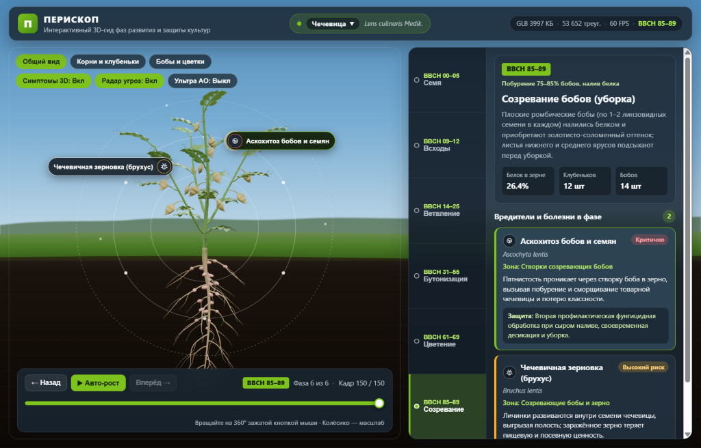
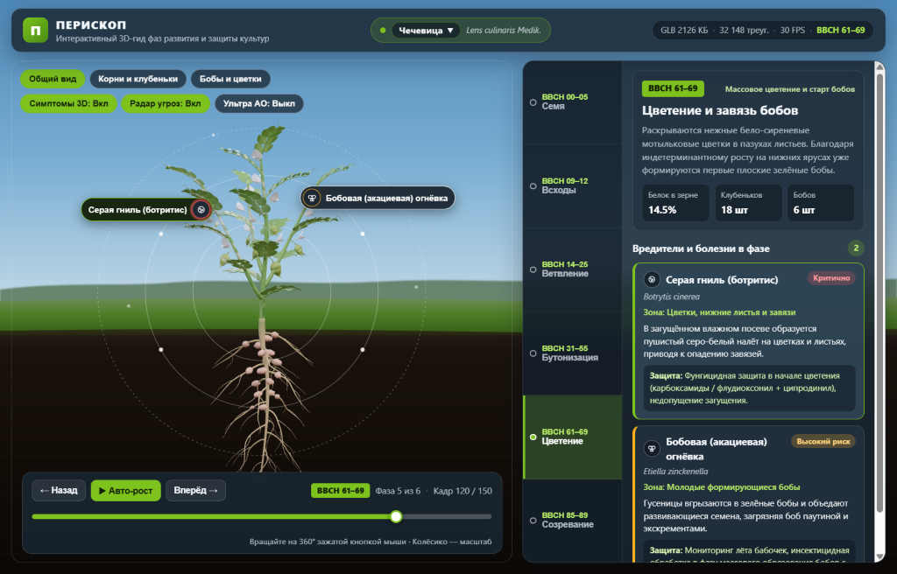
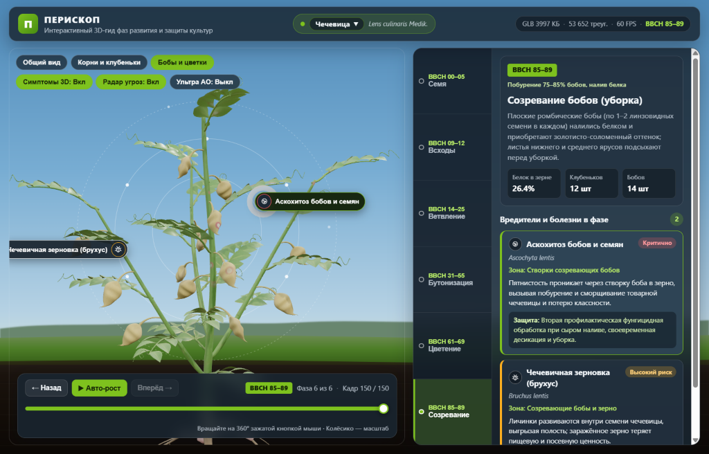
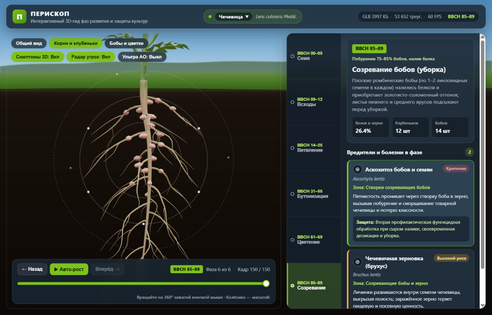
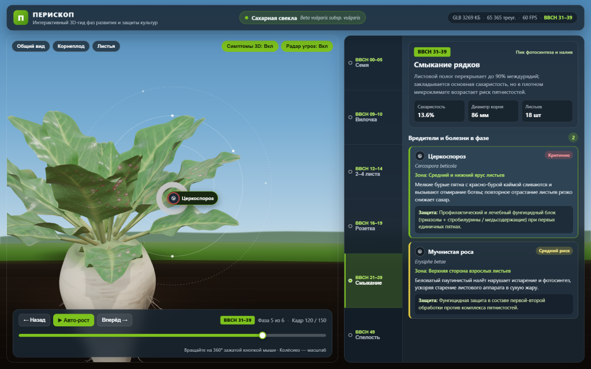
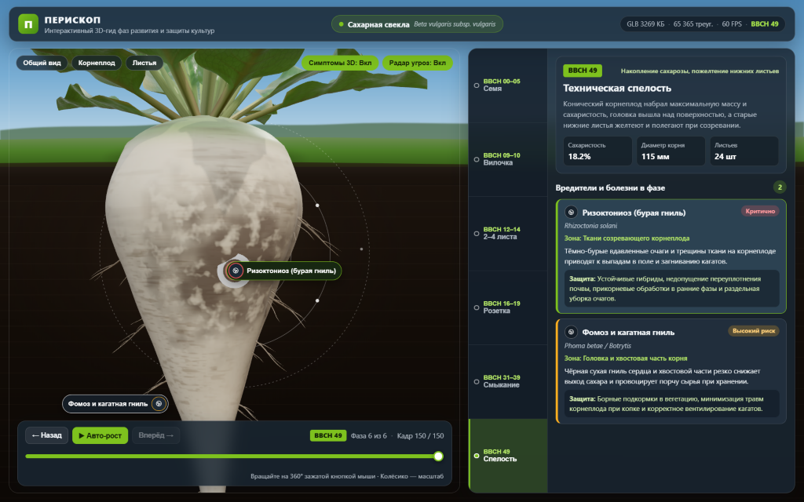

# ПЕРИСКОП — Интерактивный 3D-атлас фаз развития и защиты культур

> **🌐 Живая 3D-демо версия (GitHub Pages):**
> * **Сахарная свекла (*Beta vulgaris*):** [https://a9040000911-lgtm.github.io/periscope-3d-atlas/web/?crop=sugar_beet](https://a9040000911-lgtm.github.io/periscope-3d-atlas/web/?crop=sugar_beet)
> * **Чечевица (*Lens culinaris Medik.*):** [https://a9040000911-lgtm.github.io/periscope-3d-atlas/web/?crop=lentil](https://a9040000911-lgtm.github.io/periscope-3d-atlas/web/?crop=lentil)

Интерактивный веб-атлас жизненного цикла сельскохозяйственных культур по шкале **BBCH** с фотореалистичными 3D-моделями, процедурными GPU-симптомами болезней и вредителей в реальном времени и полностью автоматизированным headless-пайплайном генерации в **Blender 5.2 LTS**.

В атласе доступны **2 полноценные культуры** с мгновенным переключением прямо в шапке (`#crop-select`):
1. **Сахарная свекла (*Beta vulgaris subsp. vulgaris*)** — от дражированного семени (`BBCH 00–05`) до технической спелости (`BBCH 49`).
2. **Чечевица (*Lens culinaris Medik.*)** — от подземного (гипогеального) прорастания линзовидного семени (`BBCH 00–05`) через ветвление с азотфиксирующими клубеньками *Rhizobium* и бело-сиреневое цветение (`BBCH 61–69`) до созревания 14 золотистых ромбических бобов (`BBCH 85–89`).

---

## Превью 3D-сцены в браузере

### Чечевица (*Lens culinaris Medik.*)

| Созревание бобов (`BBCH 85–89`) и 3D-симптом аскохитоза | Массовое цветение (`BBCH 61–69`, мотыльковые цветки) |
| :---: | :---: |
|  |  |

| Макро-ракурс «Бобы и цветки» (чашечки, усики, аскохитоз) | Макро-ракурс «Корни и клубеньки» (22 коралловидных *Rhizobium*) |
| :---: | :---: |
|  |  |

### Сахарная свекла (*Beta vulgaris subsp. vulgaris*)

| Техническая спелость (`BBCH 49`, 24 пузырчатых листа) | Интерактивный 3D-очаг «Церкоспороза» (`BBCH 31–39`) |
| :---: | :---: |
|  |  |

| Интерактивный 3D-очаг «Ризоктониоза» (`BBCH 49`) |
| :---: |
|  |

---

## Ключевые возможности

* **Анатомические 3D-модели без ручного моделирования (Headless Blender 5.2 LTS):**
  * **Чечевица (`94` органа, `53 652` треугольника, `3.90 МБ` GLB):** подземное линзовидное семя с рубчиком (гипогеальное прорастание, неразрывное сращивание эпикотиля с корнем на всех кадрах), тонкий мочковатый корень с **18 волнистыми боковыми корешками** и **22 коралловидными розовыми клубеньками *Rhizobium*** с чечевичками аэрации, акропетально растущий 4-гранный стебель с узловыми пульвинусами + 3 конически вписанные боковые ветви, **20 сложных парноперистых листьев** (`7×4` сегментов на листочек, черешочки, прилистники, 18-сегментные спиральные усики, `COLOR_0`), **14 двухматериальных бело-сиреневых мотыльковых цветков** (5-зубчатая зелёная чашечка + двулопастной парус) и **14 двухматериальных плоских ромбических бобов** (плавная 10-сегментная зелёная плодоножка, 5-лучевая зелёная чашечка, 2K пергаментные створки с Shape Key налива `YoungFlat → Plump2Seed`).
  * **Сахарная свекла (`65 365` треугольников, `3.17 МБ` GLB):** 3-зональный профиль корнеплода со скульптурными листовыми рубцами, **26 пучковых нитевидных корешков** в двух спиральных сахарных бороздках и **24-листная пузырчатая розетка** (5 ярусов по золотому углу).
  * Сквозной 31-срезовый 10-инвариантный `BVHTree`-аудит (`--full-audit`): **0 пересечений листьев, бобов, цветков, стеблей и ветвей**, **0 проколов корня**, **0 оторванных стеблей, черешков и корешков**.
* **Фотореалистичный быстрый WebGPU / WebGL2 стек (`Three.js 0.187.0`):**
  * `WebGPURenderer` (с автоматическим fallback на `WebGL 2`), `AgXToneMapping`, мягкие самотени `PCFSoftShadowMap`, неблокирующая загрузка CC0 HDRI сельхозполя (`Poly Haven: farm_field_1k.hdr`) и физическое подповерхностное рассеивание (`MeshSSSNodeMaterial`) с просвечиванием 2 семян в молодых бобах (`lentil_pod_thickness.png`), бархатным опушением на скользящих углах, созреванием бобов от швов к центру и розовым SSS клубеньков.
  * Аналитические TSL-шейдеры без тяжёлых 3D-циклов и прямой рендер по умолчанию обеспечивают холодный старт ~1–2 с; опциональный `Ультра AO` (`RenderPipeline + SSAONode`) подгружается лениво по клику.
* **Живые 3D-симптомы болезней и вредителей на GPU (TSL):**
  * Клик по карточке угрозы или 3D-метке плавно проявляет фитопатологически точный очаг прямо на 3D-поверхности (пятна аскохитоза и церкоспороза, налёт серой гнили и мучнистой росы, очаги фузариоза и ризоктониоза, повреждения долгоносика на клубеньках и брухуса на бобах) и плавно наводит камеру на зону поражения.
* **Мультикультурная архитектура:**
  * Реестр [`data/crops_index.json`](./data/crops_index.json), динамический `<select id="crop-select">`, маршрутизация `?crop=<id>`, настраиваемые палитры созревания (`maturation_palette`), подписи ракурсов камеры (`camera_preset_labels`) и динамические карточки метрик (`metric_defs`).

---

## Быстрый запуск локально

```bash
python serve.py
```

Откройте в браузере:
* `http://127.0.0.1:8080/web/?crop=lentil` — **Чечевица**
* `http://127.0.0.1:8080/web/?crop=sugar_beet` — **Сахарная свекла**

## Пересборка 3D-ассетов и Zero-Trust аудит

```powershell
# Чечевица (Lens culinaris Medik.)
& "C:\Program Files\Blender Foundation\Blender 5.2\blender.exe" --background --python-exit-code 1 --python blender/generate_lentil.py -- --full-audit
python .agents/skills/periscope-crop-3d/scripts/audit_crop_pipeline.py --crop lentil

# Сахарная свекла (Beta vulgaris)
& "C:\Program Files\Blender Foundation\Blender 5.2\blender.exe" --background --python-exit-code 1 --python blender/generate_sugar_beet.py -- --full-audit
python .agents/skills/periscope-crop-3d/scripts/audit_crop_pipeline.py --crop sugar_beet
```

## Структура проекта

```text
├── index.html                  # Точка входа (редирект на ./web/ для GitHub Pages)
├── serve.py                    # Локальный HTTP-сервер с MIME-типами (.glb, .wasm, .hdr, .webp)
├── web/                        # Веб-приложение Three.js 0.187.0 WebGPURenderer + TSL
│   ├── index.html
│   ├── app.js
│   └── style.css
├── data/                       # Паспорта культур, шкала BBCH, 3D-якоря и профили симптомов
│   ├── crops_index.json
│   ├── sugar_beet.json
│   └── lentil.json
├── assets/                     # WebP-текстурированные .glb, статистика QA, карты толщины и HDRI
│   ├── sugar_beet.glb
│   ├── export_stats.json
│   ├── lentil.glb
│   ├── lentil_stats.json
│   └── textures/
├── blender/                    # Headless-генераторы 3D-моделей и процедурных PBR-текстур
│   ├── generate_sugar_beet.py
│   ├── pbr_textures.py
│   ├── generate_lentil.py
│   └── textures_lentil.py
└── docs/images/                # Скриншоты для документации
```

## Атрибуция ресурсов

* Дневная карта окружения `farm_field_1k.hdr`: **Poly Haven** (*Farm Field* — Dimitrios Savva & Jarod Guest), лицензия **CC0 (Public Domain)**.
