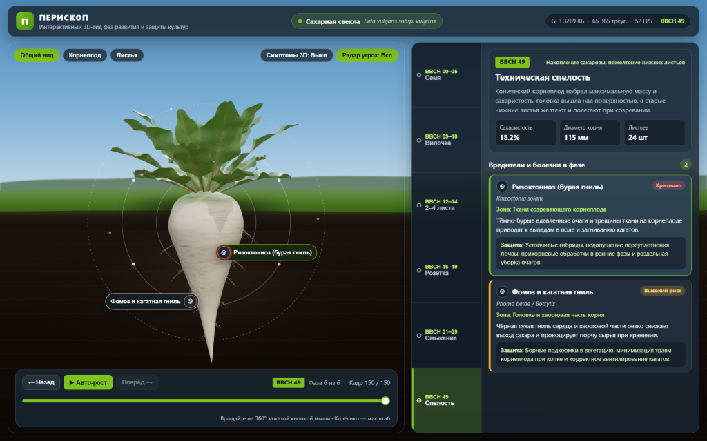

# ПЕРИСКОП — Интерактивный 3D-атлас фаз развития и защиты культур

> **🌐 Живая 3D-демо версия (GitHub Pages):** **[https://a9040000911-lgtm.github.io/periscope-3d-atlas/](https://a9040000911-lgtm.github.io/periscope-3d-atlas/)**

Интерактивный веб-атлас жизненного цикла сельскохозяйственных культур по шкале **BBCH** с фотореалистичной 3D-моделью, процедурными GPU-симптомами болезней и вредителей в реальном времени и полностью автоматизированным headless-пайплайном генерации в **Blender 5.2 LTS**.

Первая реализованная культура — **Сахарная свекла (*Beta vulgaris subsp. vulgaris*)** от дражированного семени (`BBCH 00–05`) до технической спелости (`BBCH 49`).

---

## Превью 3D-сцены (60 FPS в браузере)

| Техническая спелость (`BBCH 49`, 24 пузырчатых листа) | Интерактивный 3D-очаг «Церкоспороза» (`BBCH 31–39`) |
| :---: | :---: |
|  |  |

| Интерактивный 3D-очаг «Ризоктониоза» (`BBCH 49`) |
| :---: |
|  |

---

## Ключевые возможности

* **Анатомическая 3D-модель без ручного моделирования:**
  * 3-зональный профиль корнеплода (коническая головка со скульптурными листовыми рубцами, округлое грушевидное плечо, конический корпус с органической асимметрией) и **26 пучковых нитевидных корешков** в двух спиральных сахарных бороздках.
  * Раскидистая **24-листная розетка** (5 ярусов по филлотаксису золотого угла) с сердцевидно-яйцевидной пластинкой, 3D-межжилковой пузырчатостью, мясистым U-черешком, 3-ступенчатым развёртыванием листа из основания (Shape Keys) и индивидуальной окраской каждого листа через glTF `COLOR_0`.
  * Сквозной 31-срезовый `BVHTree`-аудит (`--full-audit`): **0 пересечений листьев**, **0 проколов корня**, **0 оторванных черешков и корешков**.
* **Фотореалистичный WebGPU / WebGL2 стек (`Three.js 0.187.0`):**
  * `WebGPURenderer` (с автоматическим fallback на `WebGL 2`), `AgXToneMapping`, мягкие самотени `PCFSoftShadowMap` (`2048×2048` десктоп / `1024×1024` мобильные).
  * `THREE.RenderPipeline + SSAONode` (`depthAwareBlur`, `builtinAOContext`, аппаратный 4× MSAA, 100% сохранение прозрачного alpha-фона над 2D-срезом поля и чернозёма).
  * Реальный CC0 HDRI сельхозполя (`Poly Haven: farm_field_1k.hdr`) + 2K Voronoi-пузырчатые PBR-карты и физическое подповерхностное рассеивание (`MeshSSSNodeMaterial`) с раздельным шейдированием верхней глянцевой и нижней матовой стороны листа (`frontFacing`).
* **Живые 3D-симптомы болезней и вредителей на GPU (MaterialX TSL):**
  * Клик по карточке угрозы или 3D-метке плавно проявляет фитопатологически точный очаг прямо на 3D-поверхности (пятна с красно-пурпурной каймой при церкоспорозе, трещиноватая сухая гниль при ризоктониозе, верхнесторонний налёт мучнистой росы, концентрические кольца фомоза, выеденные мины вредителей) и подводит камеру на макро-ракурс.
  * Отдельный переключатель **«Симптомы 3D: Вкл/Выкл»** и **«Радар угроз: Вкл/Выкл»**, двунаправленный скраббинг шкалы BBCH (`0 ↔ 150` кадров) и авто-проигрывание роста.
* **Мультикультурная архитектура:**
  * Реестр [`data/crops_index.json`](./data/crops_index.json), маршрутизация `?crop=<id>` и динамические карточки метрик (`metric_defs`) готовы к подключению озимой пшеницы, кукурузы, подсолнечника и рапса.

---

## Быстрый запуск локально

```bash
python serve.py
```

Откройте в браузере: `http://127.0.0.1:8080/web/`

## Пересборка 3D-ассета в Headless Blender 5.2 LTS

```powershell
& "C:\Program Files\Blender Foundation\Blender 5.2\blender.exe" --background --python-exit-code 1 --python blender/generate_sugar_beet.py -- --full-audit
python .agents/skills/periscope-crop-3d/scripts/audit_crop_pipeline.py --crop sugar_beet
```

## Структура проекта

```text
├── index.html                  # Точка входа (редирект на ./web/ для GitHub Pages)
├── serve.py                    # Локальный HTTP-сервер с MIME-типами (.glb, .wasm, .hdr, .webp)
├── web/                        # Веб-приложение Three.js 0.187.0 WebGPURenderer + TSL
│   ├── index.html
│   ├── app.js
│   └── style.css
├── data/                       # Паспорта культур, шкала BBCH, 3D-якоря и профили симптомов
│   ├── crops_index.json
│   └── sugar_beet.json
├── assets/                     # Экспортированный Draco+WebP .glb, статистика, карты толщины и HDRI
│   ├── sugar_beet.glb
│   ├── export_stats.json
│   └── textures/
├── blender/                    # Headless-генератор 3D-модели и 2K PBR-текстур
│   ├── generate_sugar_beet.py
│   └── pbr_textures.py
└── docs/images/                # Скриншоты для документации
```

## Атрибуция ресурсов

* Дневная карта окружения `farm_field_1k.hdr`: **Poly Haven** (*Farm Field* — Dimitrios Savva & Jarod Guest), лицензия **CC0 (Public Domain)**.
